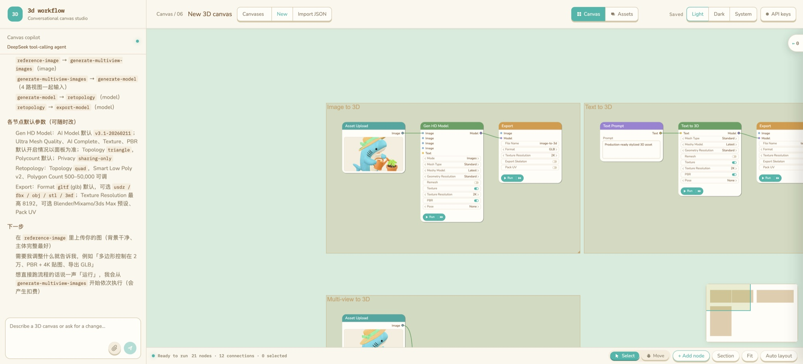
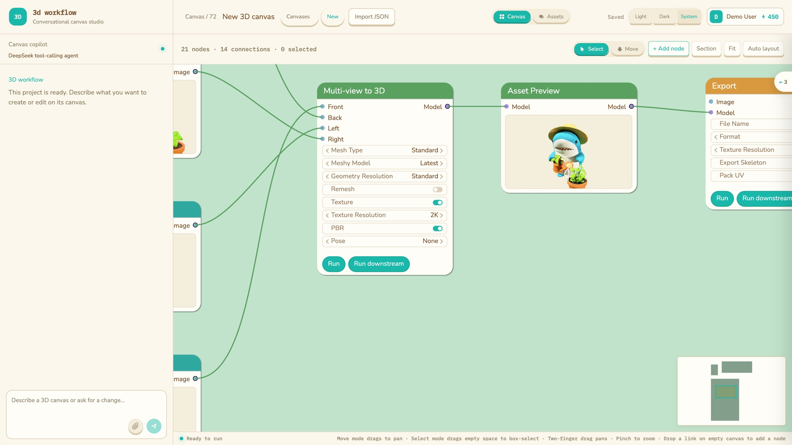
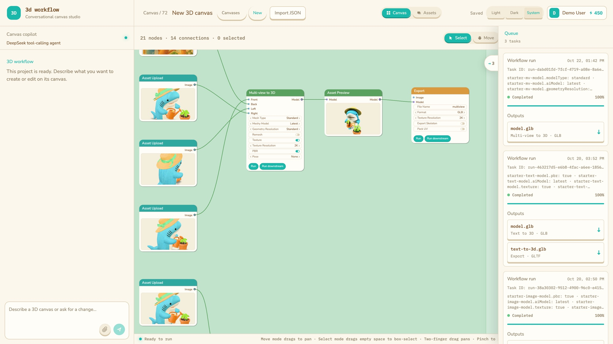

# Forge3D

[Live Demo](https://forge3d.lumixraku.org/) | [Design and Architecture](docs/README.md) | [Local Database](docker/README.md) | [HTTP API](docs/api.md)

Forge3D is a visual 3D canvas for AI generation workflows. Describe a goal in natural language or edit the canvas directly, then connect image input, model generation, processing, and export steps into a reusable workflow.

https://github.com/user-attachments/assets/73b0572d-3536-45a3-afb6-42b2e304b4dc



## Screenshots

Nodes show their inputs, parameters, previews, and run actions directly on the canvas. Cascading parameters such as Mesh Type → Meshy Model → Geometry Resolution appear under the control that owns them.



The task list slides in from the right with each run's status, progress, and downloadable outputs. Its handle stays on the panel's left edge.



## Canvas controls

- Pinch or Ctrl + scroll zooms the canvas, including over node buttons and the minimap. The page itself never zooms.
- Two-finger drag pans. Move mode drags to pan; Select mode drags empty space to box-select.
- Drop a link on empty canvas to add a node. Select, Move, Add node, Section, Fit, and Auto layout sit in the bottom bar next to the run status.

## Features

- Create, connect, duplicate, and organize workflow nodes on an infinite canvas.
- Configure image, model, material, format, and export parameters on each node.
- Drop local images or 3D files onto the canvas as workflow inputs.
- Ask the DeepSeek Agent to inspect the current canvas, build workflows, update parameters, and request decisions when needed.
- Run one node, a node and its downstream dependencies, or the complete workflow.
- Inspect per-node status, progress, outputs, duration, and errors.
- Use the Mock provider to explore the complete workflow without generation-service credentials.
- Use Tripo or Meshy for real image-to-3D, model processing, and related generation tasks.
- Connect generated results to downstream processing nodes and preview images and 3D models on the canvas.
- Persist canvases, sessions, executions, and Agent state so work can continue after reopening the application.
- Receive execution progress and collaboration updates over SSE; multiple browser tabs can observe the same canvas.

## Node parameters

Each node type declares its controls in `src/canvas-schema.ts`. A parameter has a stable `key`, a display `label`, a `control` (`text`, `textarea`, `select`, `segmented`, `slider`, or `toggle`), and optional `options` or `range`. Stored config stays a flat map of those keys. Hiding a control does not delete its saved value.

Cascades follow a ComfyUI DynamicCombo. The group lives on the option, in `inputs`. The selected option's inputs are drawn directly under that control, and choosing another option takes that group off the node. An input can itself be a menu or a toggle with its own options. `AI Model` → `v3.1 · Best Quality` owns Ultra Mesh Quality. `Format` → `FBX` owns FBX Preset. Meshy `Mesh Type` → `Standard` owns the standard model list, and that list's `Latest` option owns Geometry Resolution.

A toggle is the same shape with one option, `{ value: true, inputs }`. While the toggle is on, that option's group is shown. Meshy Texture owns Texture Resolution and PBR. Remesh owns Topology and Target Polycount. Hidden values stay saved.

Two related mechanisms do not hide a control:

- `range.rules` keeps the control on screen and changes its minimum or maximum when a condition matches. Quad topology, for example, lowers the polycount maximum.
- `effects` writes other config fields when a value is chosen. A write can select a different option, which swaps the group under that control.

## Ways to Run Forge3D

### Local Runtime

The local Node runtime provides the complete development and generation experience:

- DeepSeek Agent support.
- Mock, Tripo API, and Meshy API providers.
- Image and 3D file uploads.
- Binary persistence for uploaded assets and generated results in a local SQLite file.
- Local debugging, testing, and frontend or backend development.

Application data and assets live in `server/data/forge3d.sqlite`. The file is created on first start. No database server is required.

### Cloudflare Web Deployment

The [live application](https://forge3d.lumixraku.org/) runs on Cloudflare Workers:

- Use the canvas, edit nodes, save workflows, manage sessions, and run the Worker-compatible Agent features in a browser.
- Application data is persisted in Cloudflare D1.
- The Mock provider is available without Tripo or Meshy credentials.
- Publicly accessible external image URLs can be displayed.
- R2 is not currently bound, so user-uploaded images and models cannot be persisted by the Worker.
- The Worker does not run the Node-only Tripo, Meshy, or local asset-storage paths.

Cloudflare D1 and the local SQLite file are independent stores. Both use the SQL in `migrations/`. Deploying to Cloudflare does not upload or synchronize canvases from the local file.

### DeepSeek Harness Plugin

The same canvas also ships as a DeepSeek Harness bundle (`dsh-plugin/`). It serves the app under `/forge3d/`
inside a `conversation.view` tab and gives the harness agent seven canvas tools, so a conversation and a
workflow share one window. The harness conversation *is* the agent there, which is why that build has no
in-app copilot. See [`dsh-plugin/README.md`](dsh-plugin/README.md).

## Build Targets

Two Vite configs build one source tree into two different applications:

| Config | Output | `base` | Copilot |
| --- | --- | --- | --- |
| `vite.config.ts` | `dist/` (local + Cloudflare) | `/` | included |
| `vite.config.plugin.ts` | `dsh-plugin/lib/client.js` | — (mounted in the DSH page) | **not built in** |

### Build-time specialization

A difference between the two builds must be decided **at build time**, not at runtime. A conditional render, a query
parameter, or a `VITE_` flag all leave the code in the bundle — the branch is just never taken. That is
acceptable for behaviour, fatal for weight: the plugin would ship the whole tiptap editor for a panel it
cannot open.

Two mechanisms exist, and only these two:

1. **`define`** — `__FORGE3D_EMBED__` is `false` in the web config and `true` in the plugin config. Use it
   for layout and behaviour that differ while the code is shared. It is declared in `src/env.d.ts`.
   What it currently controls: the agent column in the canvas grid, and whether the API-key dialog asks
   for a DeepSeek key (the harness brings its own model, so only the 3D provider key means anything there).
2. **Module swap** — a `resolveId` rule in `vite.config.plugin.ts` that points a real module at a stub.
   This removes the module *and its dependencies* from the graph.

Current swaps:

| Real module | Harness build resolves to | Removes |
| --- | --- | --- |
| `src/components/ChatPanel.tsx` | `src/components/NoAgentPanel.tsx` | `marked`, `dompurify`, message rendering |
| `src/state/composer.ts` | `src/state/composer.harness.ts` | `@tiptap/*`, ProseMirror, the attachment node view |

Adding a swap:

1. Extract the heavy or agent-only part into its own module. It must be reachable from a single import.
2. Write a stub that exports **the same shape**, with inert values (`state(null)`, `derived(() => false)`,
   no-op functions). Callers stay unchanged, so the shared code needs no guards.
3. Add a `resolveId` rule in `vite.config.plugin.ts` and a row to the table above.

Two traps worth knowing:

- `resolve.alias` matches on the **module specifier**, and its replacement is substituted textually. An
  absolute path as the replacement turns `./components/ChatPanel` into
  `./components//Users/...`. Use a `resolveId` rule, which receives the specifier and returns a resolved
  path.
- A regex that does not match fails **silently**: the build stays green and the module is still bundled.
  Verify after adding one:

```bash
npx vite build --config vite.config.plugin.ts
grep -c ProseMirror dsh-plugin/lib/client.js   # expect 0 in the plugin build, >0 in dist/
```

## Prerequisites

Prepare the following configuration for the features you intend to use.

### Required Configuration

Create a `.env` file in the repository root. It supplies the DeepSeek Agent API key:

```bash
cp .env.example .env
```

Set your DeepSeek API key:

```dotenv
DEEPSEEK_API_KEY=your_DeepSeek_API_key
```

`DEEPSEEK_BASE_URL` and `DEEPSEEK_MODEL` already have defaults and normally do not need to be changed:

```dotenv
DEEPSEEK_BASE_URL=https://api.deepseek.com
DEEPSEEK_MODEL=deepseek-chat
```

You may leave `DEEPSEEK_API_KEY` empty if you only want to use the canvas and Mock workflows without the Agent.

### Local Database

The Node service opens `server/data/forge3d.sqlite` (override with `SQLITE_PATH`). On startup it applies `migrations/`, then fills an empty database from `server/seed/`. The file stays on disk between runs. Uploaded images and models are stored in the same file.

Set `SQLITE_PATH` only when the database file should live somewhere else:

```dotenv
SQLITE_PATH=server/data/forge3d.sqlite
```

### Optional Generation Services

Configure Tripo to enable real Tripo generation and processing nodes:

```dotenv
TRIPO_API_KEY=your_Tripo_API_key
TRIPO_BASE_URL=https://openapi.tripo3d.ai/v3
```

Configure Meshy to enable Meshy-backed nodes such as `generate-model`:

```dotenv
MESHY_API_KEY=your_Meshy_API_key
MESHY_BASE_URL=https://api.meshy.ai
```

The application still works with the Mock provider when these keys are absent. Never commit `.env` or any API key to Git.

## Run Locally

Requirements: Node.js 22.5+ (the built-in `node:sqlite` module) and pnpm `11.16.0`.

```bash
corepack enable
corepack prepare pnpm@11.16.0 --activate
pnpm install --frozen-lockfile
cp .env.example .env
pnpm dev
```

Open the local frontend URL printed in the terminal. `pnpm dev` starts the frontend, Node API, and local Agent service together, and selects available ports automatically. The API creates `server/data/forge3d.sqlite` if it is not there yet.

Common verification commands:

```bash
pnpm test
pnpm run typecheck
pnpm run build
```

To use the built-in DeepSeek loop instead of the local Pi Agent service, set this in `.env`:

```dotenv
AGENT_SERVICE_URL=direct
```

## Deploy to Cloudflare

Cloudflare deployment uses the existing Worker, D1, and static asset configuration. Before deploying:

- Install Wrangler and authenticate with your Cloudflare account.
- Make sure the Worker name, custom domain, and D1 database in `wrangler.toml` belong to your Cloudflare account.
- Configure the `DEEPSEEK_API_KEY` Worker secret if the deployed application should use the DeepSeek Agent.
- Apply the D1 migration.

Run the complete release process:

```bash
pnpm run cf:release
```

This command runs the tests, applies remote D1 migrations, builds the frontend assets, and deploys the Worker. To run individual stages instead:

```bash
pnpm run cf:build
pnpm run cf:d1:migrate
pnpm run cf:deploy
```

Cloudflare does not open the local SQLite file. The web deployment uses the D1 binding from `wrangler.toml`; persistent image and model uploads require a future R2 integration.

## Documentation

- [Documentation index](docs/README.md): architecture, design details, protocols, and API references.
- [Project reference](docs/project-reference.md): product capabilities, data model, runtimes, and deployment reference.
- [Execution engine](docs/execution-engine.md): node scheduling, dependencies, failure handling, and review gates.
- [Agent tools](docs/canvas-tool-calls.md): tool definitions, parameters, and validation rules.
- [SSE protocol](docs/agent-sse-data-design.md): progress events, reconnect behavior, and continuation.
- [HTTP API](docs/api.md): canvas, session, execution, and asset endpoints.
- [Meshy Agent SSE](docs/meshy-agent-sse-protocol.md): Agent SSE conventions for Meshy-related execution.
- [Todo](docs/todo.md): current limitations and planned work.
- [Progress](docs/progress.md): current project status organized by capability.
- [Local database](docker/README.md): the SQLite file and what it stores.

## Current Limitations

- The Cloudflare deployment uses D1 but does not have R2, so application uploads of images and 3D files cannot be persisted.
- Real Tripo and Meshy execution is currently available only through the local Node runtime; the Cloudflare deployment can use Mock workflows.
- The local SQLite file and Cloudflare D1 do not synchronize automatically.
